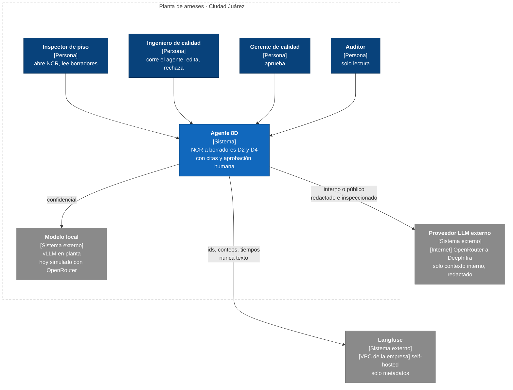
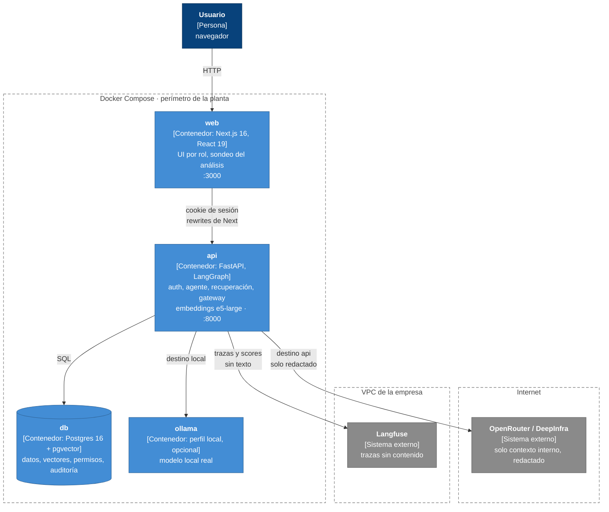
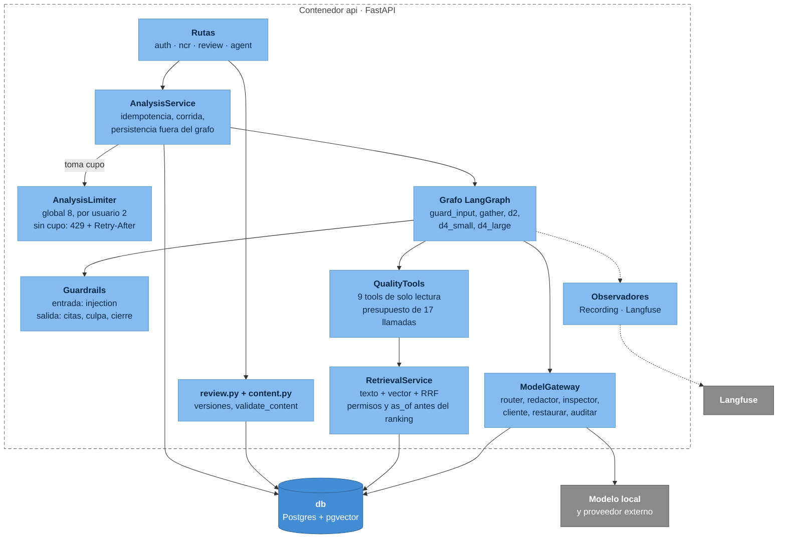
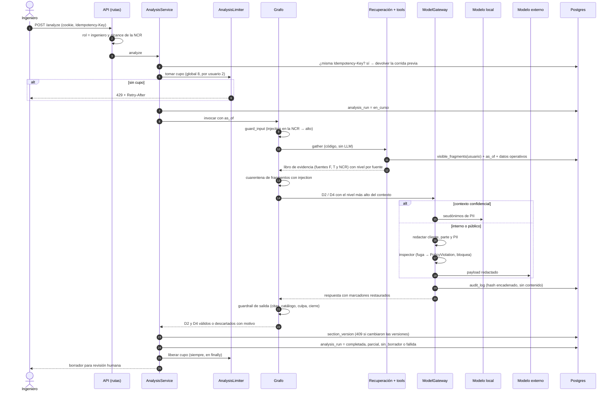

# Arquitectura (C4) y flujo de datos

Agente de Causa Raíz 8D con router de confidencialidad. Todo el sistema corre en Docker Compose; los datos son
sintéticos. Cada afirmación de este documento se puede comprobar en el archivo o la prueba que se cita.

## Nivel 1 — Contexto

Fuera de alcance: MES, ERP, QMS reales, fotos y planos, cerrar un 8D sin ingeniero.

## Nivel 2 — Contenedores

| Contenedor | Responsabilidad | Evidencia |
|---|---|---|
| `web` | UI por rol, polling del análisis, revisión | `apps/web`, `docker-compose.yml` |
| `api` | Auth por sesión, módulos `auth` y `ncr`, agente, recuperación, gateway | `apps/api/app` |
| `db` | Fuente única: documentos, vectores, permisos, versiones, auditoría | migraciones `0001`–`0014` |
| `ollama` | Modelo local real (perfil `local`) | `docker-compose.yml` |

Volúmenes montados en `api`: `data/` (corpus y CSV), `evals/`, `traces/` y el caché de modelos de embeddings.
La base solo escucha en `127.0.0.1:5432`.

## Nivel 3 — Componentes de la API

Reglas de diseño que el diagrama no muestra:

- **Las tools las llama el código, no el LLM.** El modelo solo redacta y cita (ADR 0001).
- **Los nodos reciben el gateway, nunca un cliente de LLM** (`app/agent/llm/gateway.py`).
- **La persistencia ocurre fuera del grafo** y devuelve 409 si alguien cambió las versiones mientras el modelo
  trabajaba (`test_concurrent_change_while_model_works_is_a_conflict`).

## Flujo de datos de `POST /ncrs/{id}/analyze`

### Niveles de confidencialidad y destino

| Nivel más alto en el contexto | Destino permitido | Tratamiento |
|---|---|---|
| Confidencial | Solo local | Seudónimos de PII, también hacia el local |
| Interno / público | Local o API | A la API: redacción de clientes, partes y PII + inspector |

La base lo impone además del código: `CHECK (NOT (detected_level = 'confidencial' AND destination = 'api'))` en
`audit_log`. Con OpenRouter en ambos destinos (modo de pruebas), la garantía "lo confidencial no sale de la planta" no se
cumple; queda marcado `simulated` en la auditoría y solo se acepta con datos ficticios.

### Qué se guarda y dónde

| Dato | Dónde | Contenido en claro | Retención |
|---|---|---|---|
| Documentos y fragmentos | `document`, `fragment` (pgvector) | Sí | Mientras exista el corpus |
| Borradores y revisión | `section_version`, `citation` (inmutables) | Sí | Permanente |
| Llamadas a modelos | `audit_log` | **No**: ids, nivel, destino, modelo, tokens, costo, latencia, tags | Permanente (solo inserción) |
| Seudónimos | `pseudonym_map` | Sí (valor real ↔ marcador) | `expires_at`: NCR abierta + 90 días; **la purga no está implementada** |
| Trazas | Langfuse (VPC) | **No**: ids, conteos, tiempos, códigos de evento | Política de Langfuse |
| Traza local de corridas | `traces/` (JSON) | Solo con `TRACE_EXPORTER=json` y en el eval | Local |
