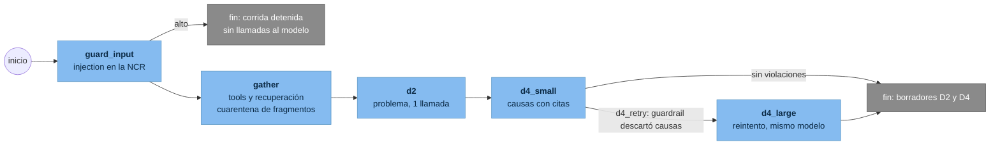
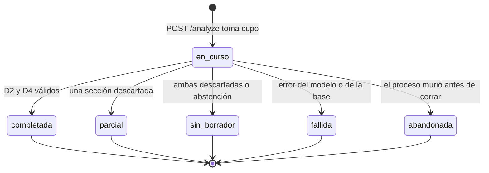
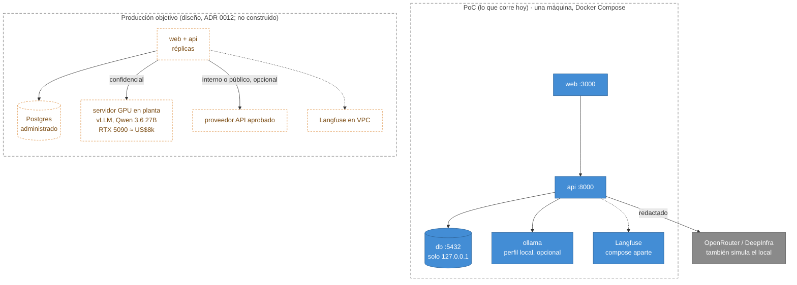
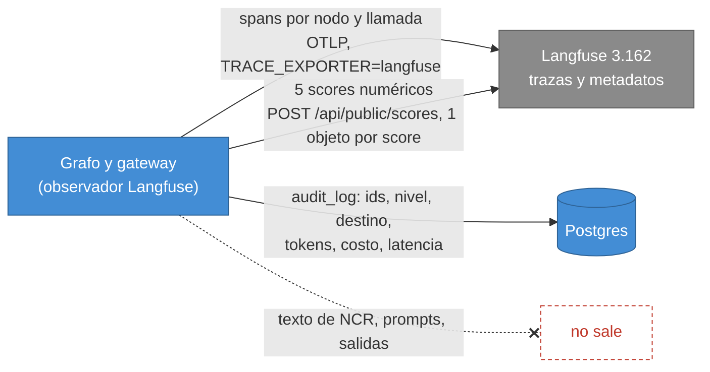
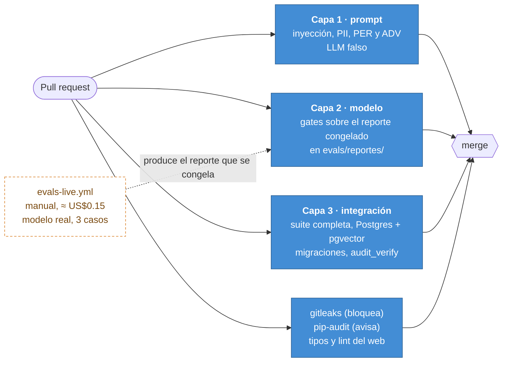
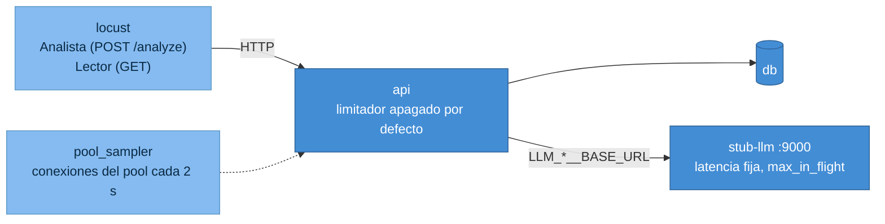

# Diagramas complementarios

Complementan `c4.md` (contexto, contenedores, componentes y secuencia) y `../seguridad/modelo-de-amenazas.md` (flujo de
datos con fronteras de confianza). Cada bloque es Mermaid: GitHub lo dibuja y se puede pegar tal cual en
<https://mermaid.live>.

## 1. Flujo del agente (LangGraph)

El reintento (`d4_large`) duplica costo y tiempo; con Qwen 3.6 27B escaló 22 de 36 corridas (ADR 0012). Si ayuda a pasar
el caso no está medido todavía.

## 2. Estados de una corrida

El cierre ocurre en un `finally`; `abandonada` solo la marca el proceso que arranca después (hoy no hay reaper: pendiente
con el análisis asíncrono).

## 3. Despliegue

Lo punteado en naranja es diseño: el servidor GPU no existe y su throughput no está medido (ADR 0012).

## 4. Observabilidad: qué viaja y qué no

Scores: `escalo_a_modelo_grande`, `violaciones_guardrail`, `errores_llm`, `fragmentos_en_cuarentena`,
`disciplinas_bloqueadas`. Se envían por HTTP propio porque el SDK 5 manda un arreglo que el servidor 3.162 rechaza con 400
(`docs/operacion/observabilidad.md`).

## 5. CI en tres capas

La capa 2 evalúa un reporte, no el modelo: cambiar modelo o prompt exige volver a correr el eval y congelar el reporte en
el mismo PR.

## 6. Topología de la prueba de carga

El stub quita al proveedor de la medición: mide la API, el pool y la base, no ningún modelo. Salidas en `traces/carga/`.
