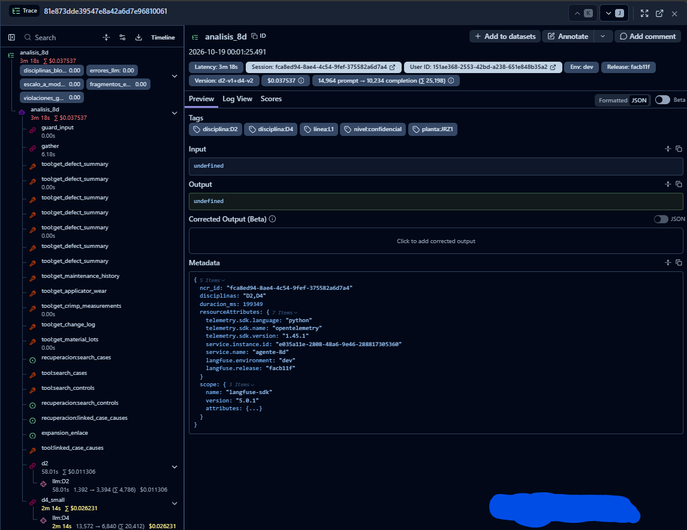
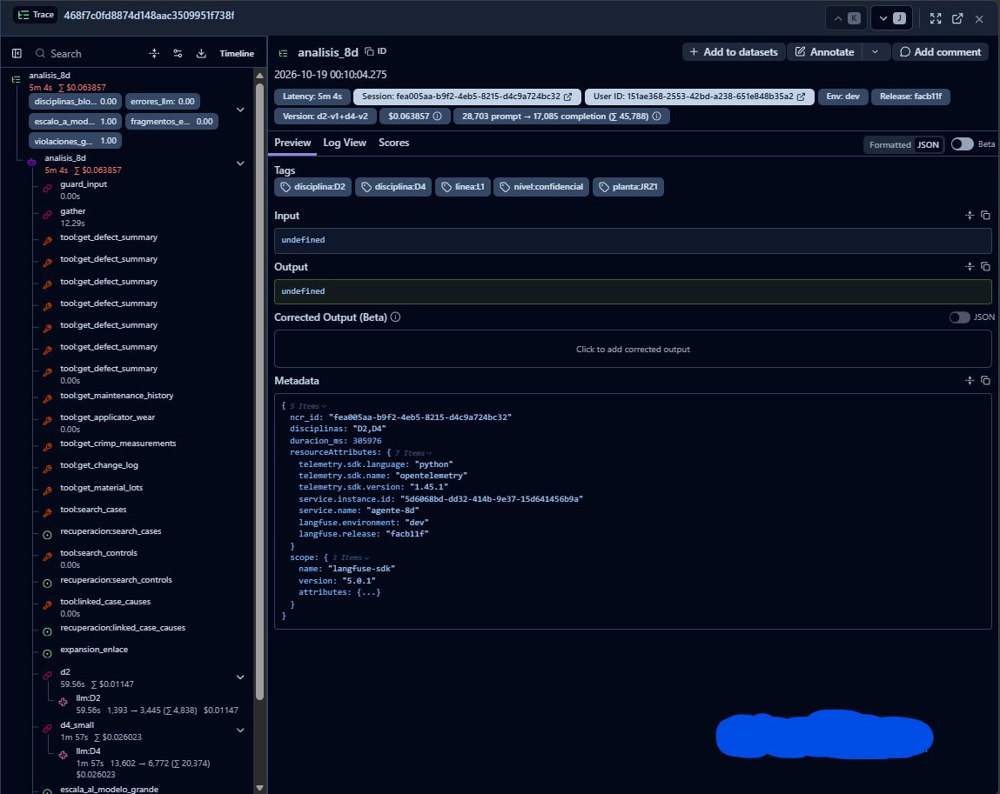
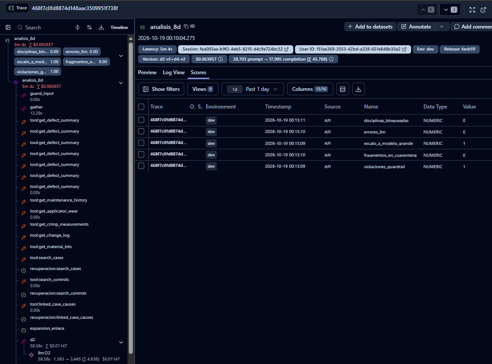

# Observabilidad: qué se ve, dónde y qué falta

Dos fuentes que se corresponden por `trace_id` (el id de la corrida, 32 hex):

- **Langfuse** (VPC): la traza de cada análisis, para ver dónde se fue el tiempo y los tokens. **Sin texto**: ids, conteos,
  tiempos y códigos de evento (ADR 0008).
- **`audit_log` en Postgres**: una fila por llamada al modelo, solo-inserción con hash encadenado, con tokens, costo,
  latencia y tags. Es la fuente de verdad del costo y no depende de que Langfuse esté arriba.

## Qué muestra una traza real

Dos corridas del 19 oct 2026 en Langfuse (entorno `dev`, release `facb11f`, versión de prompts `d2-v1+d4-v2`, NCR confidencial
de la línea L1): una que no escaló y otra que escaló al modelo grande. Los tramos son los mismos: `guard_input`, `gather`
(las tools y las búsquedas, sin LLM), `d2`, `d4_small` y, en la segunda, el evento `escala_al_modelo_grande` con su segunda
llamada.





| | Corrida normal | Corrida con escalamiento |
|---|---|---|
| Traza | `81e873dd…` | `468f7c0f…` |
| Duración | 3 min 18 s | 5 min 4 s |
| `gather` (datos y búsquedas) | 6.2 s | 12.3 s |
| `d2` | 58.0 s · US$0.0113 | 59.6 s · US$0.0115 |
| `d4_small` | 2 min 14 s · US$0.0262 | 1 min 57 s · US$0.0260 |
| Segunda llamada (`d4_large`) | no hubo | ≈ 1 min 55 s · ≈ US$0.026 (por diferencia con el total; no se ve completa en la captura) |
| Costo total | US$0.0375 | US$0.0639 |
| Tokens (entrada → salida) | 14,964 → 10,234 | 28,703 → 17,085 |
| Scores | todos en 0 | `escalo_a_modelo_grande` = 1 y `violaciones_guardrail` = 1; el resto en 0 |

Los cinco scores de la segunda traza se ven en su pestaña *Scores* (origen `API`, tipo numérico), lo que confirma que
llegan por el camino corregido más abajo:



Lo que estas trazas permiten afirmar:
- **El tiempo está en el modelo.** Entre `d2`, `d4_small` y la segunda llamada se va más del 95 % de la duración; `gather`
  son 6–12 s (3–4 %). Optimizar la recuperación no cambia el panorama.
- **Escalar casi duplica el costo y alarga la corrida** (US$0.0375 → US$0.0639, 3 min 18 s → 5 min 4 s). Son dos NCR
  distintas, así que la comparación es orientativa y no un experimento controlado; `d2` y `d4_small` cuestan lo mismo en
  ambas, y la diferencia es la segunda llamada.
- **La traza de 5 min 4 s (306 s) está en el orden del p95 del dashboard (306.4 s).** Es coherente con que el p95 lo
  marquen las corridas que escalan; es una lectura, no una medición separada.
- **`Input` y `Output` salen como `undefined` a propósito** (ADR 0008): la traza lleva ids, conteos, tiempos y eventos,
  nunca texto de la NCR ni de la respuesta. La metadata trae el `ncr_id` (un identificador), las disciplinas y la duración.
- La generación `llm:D2` muestra su duración real (58.0 s): confirma la corrección 1 de la lista de abajo.

Dos trazas son ejemplos, no estadística. Para la distribución están el dashboard y `audit_log`.

### Una corrida anterior (18 oct)

La traza `a7a1ffe2…` (análisis de D4, 18 oct 2026, Qwen 3.6 27B) tiene 28 observaciones:

| Tramo | Duración | Qué dice |
|---|---|---|
| `guard_input` | 0.00 s | El guardrail de entrada no vio inyección |
| `gather` (13 tools, 3 búsquedas) | 0.34 s | Etapa de datos: SQL y búsqueda híbrida, sin LLM |
| `d4_small` | 103 s | Primera llamada al modelo (13,900 → 6,777 tokens, US$0.026) |
| evento `violaciones` + `escala_al_modelo_grande` | | El guardrail de salida rechazó el borrador |
| `d4_large` | 94 s | Segunda llamada, mismo modelo (13,959 → 7,163, US$0.027) |
| **Total** | **198 s** | **US$0.0535** · 27,859 tokens de entrada, 13,940 de salida |

Lo que esta traza permite afirmar, con evidencia y no de memoria:
- El tiempo está en el modelo (197 de 198 s); los datos son 0.34 s. Optimizar la recuperación no cambia nada.
- Esta corrida costó el doble por el escalamiento: una segunda llamada completa al mismo modelo.
- En el humo anterior `gather` tardó 34 s. Aquí 0.34 s: era un arranque en frío del modelo de embeddings. (En las trazas del 19 oct `gather` tomó 6–12 s con corridas simultáneas; la conclusión no cambia.)

Correcciones al exportador a partir de esa misma traza (hechas, falta reconstruir la imagen para verlas):
1. Las `generation` salían con **duración 0** porque se creaban al terminar la llamada. Ahora se abren antes y cuelgan de su
   etapa, así la latencia por llamada es la real.
2. La traza no tenía usuario, sesión, etiquetas ni versión. Ahora lleva `user_id` (id interno, no nombre), `session_id` = la
   NCR, `version` = versión del prompt y etiquetas `nivel:`, `planta:`, `linea:`, `disciplina:`.
3. Scores en línea por corrida (deterministas, sin juez de LLM): `escalo_a_modelo_grande`, `violaciones_guardrail`,
   `errores_llm`, `fragmentos_en_cuarentena`, `disciplinas_bloqueadas`.

   Verificado con la traza `c9a9eccd…` (19 oct 2026): las correcciones 1 y 2 se vieron en Langfuse; los scores **no llegaron**.
   Causa: el SDK 5 los manda en un arreglo a `POST /api/public/scores` y el Langfuse self-hosted 3.162 solo acepta un
   objeto (400 `expected object, received array`); el SDK lo registra en un hilo de fondo y descarta el score. Ahora el
   observador manda cada score como objeto con `id` determinista (`<traza>-<nombre>`), y un rechazo se registra como
   advertencia. Lección: las pruebas con un cliente falso no lo habrían visto; hay una prueba contra un servidor HTTP
   que acepta objeto y rechaza arreglo (`tests/agent/test_observe_langfuse_trace.py`).

   Con la traza posterior se confirmó que los 5 scores llegan, que la generación `llm:D4` trae su metadata (`destino`,
   `nivel`, `tier`, `intentos`, `latencia_ms`, `razonamiento_tokens`, `salida_visible_tokens`, `finish_reason`) y que el
   JSON exportado desde la interfaz **no** incluye la metadata por observación (solo la de la traza): no es un fallo del
   exportador. Los scores se crean al primer uso; no hay nada que dar de alta en Langfuse (las *score configs* son
   opcionales y solo validan rangos).

Qué **no** miden esos scores: no dicen si la causa propuesta es correcta (eso es el eval con respuesta esperada). Miden
cuánto trabajo de contención hizo el sistema. Una subida sostenida del escalamiento o de las violaciones es la señal de
deriva que se puede vigilar en producción sin etiquetas.

El entorno (`dev`) viene de `ENTORNO` (`LANGFUSE_TRACING_ENVIRONMENT` en el SDK); la versión del código, de `GIT_SHA`
como `LANGFUSE_RELEASE`.

## Costo por request y por feature (Postgres)

Las consultas se probaron contra el esquema; con la base vacía devuelven cero filas.

```sql
-- Costo y latencia por análisis (trace_id), últimos 30 días
SELECT trace_id,
       min(created_at)           AS inicio,
       count(*)                  AS llamadas,
       sum(tokens_in)            AS tokens_in,
       sum(tokens_out)           AS tokens_out,
       round(sum(cost_usd), 4)   AS costo_usd,
       sum(latency_ms) / 1000    AS segundos_de_modelo
FROM audit_log
WHERE trace_id IS NOT NULL AND stage IN ('D2', 'D4') AND created_at > now() - interval '30 days'
GROUP BY trace_id
ORDER BY inicio DESC;
```

```sql
-- p50 y p95 del costo y de la espera de modelo por análisis, y costo total, por feature y destino
WITH por_analisis AS (
  SELECT trace_id,
         tags ->> 'feature'  AS feature,
         destination::text   AS destino,
         sum(cost_usd)       AS costo,
         sum(latency_ms)     AS ms
  FROM audit_log
  WHERE trace_id IS NOT NULL AND stage IN ('D2', 'D4') AND created_at > now() - interval '30 days'
  GROUP BY trace_id, tags ->> 'feature', destination
)
SELECT feature, destino, count(*) AS analisis,
       round(percentile_cont(0.5)  WITHIN GROUP (ORDER BY costo)::numeric, 4) AS costo_p50,
       round(percentile_cont(0.95) WITHIN GROUP (ORDER BY costo)::numeric, 4) AS costo_p95,
       round(percentile_cont(0.95) WITHIN GROUP (ORDER BY ms)::numeric / 1000, 0) AS espera_modelo_p95_s,
       round(sum(costo), 2) AS costo_total
FROM por_analisis
GROUP BY feature, destino;
```

Con destino `local` el costo del proveedor es el del modelo simulado; con hardware propio el costo es fijo y se imputa
(ADR 0012), no sale de esta consulta.

## Dashboards y alertas: qué hay y qué falta

- **Dashboard en Langfuse (creado el 19 oct 2026, 9 widgets):** latencia p50 y p95 de trazas, latencia p95 filtrada por
  nombre de traza (en el tiempo), costo p95 por traza, costo total por etiqueta, promedio y suma de scores numéricos
  (en el tiempo) y tokens por modelo. Lectura del día de la captura, sobre las corridas dev del 18 y 19 oct:

  | Widget | Valor | Contra el umbral |
  |---|---|---|
  | Latencia p50 de trazas | 104.5 s (el widget muestra `104.549K`; Langfuse reporta ms, coherente con la traza de 198 s) | — |
  | Latencia p95 de trazas | 306.4 s | SLO de la ruta local ≤ 1,200 s (ADR 0012): dentro. SLO por API ≤ 180 s del runbook: **fuera**, ya reconocido en el ADR |
  | Costo p95 por traza | US$0.059 | Umbral propuesto US$0.10: dentro |
  | Promedio del score de escalamiento | 0.357 | Umbral propuesto 60 %: dentro (coincide con el 33–40 % medido) |

  Captura del dashboard: `docs/operacion/langfuse-dashboard-slo.png`.

  ### Cómo recrear el dashboard (Dashboards → New dashboard → Add widget)

  Langfuse permite exportar e importar dashboards como JSON, pero no se aprovisionan al arrancar la instancia. Este
  documento es la definición: quien integre el proyecto crea un dashboard vacío y añade estos widgets. Todos usan el rango
  de fechas del dashboard. Los nombres de campo son los del constructor de widgets de Langfuse.

  | # | Widget | Vista (View) | Métrica y agregación | Filtro | Agrupar por | Gráfico |
  |---|---|---|---|---|---|---|
  | 1 | Latencia p50 de trazas | Traces | Latency · p50 | — | — | Número |
  | 2 | Latencia p95 de trazas | Traces | Latency · p95 | — | — | Número |
  | 3 | Latencia p95 de `analisis_8d` en el tiempo | Traces | Latency · p95 | Name = `analisis_8d` | — | Línea (tiempo) |
  | 4 | Costo p95 por traza | Traces | Total Cost · p95 | Name = `analisis_8d` | — | Número |
  | 5 | Costo total por etiqueta | Traces | Total Cost · Sum | — | Tags | Barras |
  | 6 | Promedio de scores en el tiempo | Scores (numéricos) | Value · Avg | — | Name (el score) | Línea (tiempo) |
  | 7 | Suma de scores en el tiempo | Scores (numéricos) | Value · Sum | — | Name (el score) | Línea (tiempo) |
  | 8 | Tokens por modelo | Observations | Total Tokens · Sum | Type = Generation | Provided Model Name | Barras |
  | 9 | Escalamiento al modelo grande | Scores (numéricos) | Value · Avg | Name = `escalo_a_modelo_grande` | — | Número |

  Scores que emite el exportador por análisis: `escalo_a_modelo_grande`, `violaciones_guardrail`, `errores_llm`,
  `fragmentos_en_cuarentena`, `disciplinas_bloqueadas`. La traza se llama `analisis_8d`. Langfuse reporta la latencia en
  milisegundos (un `104.549K` son 104.5 s).

  **Verificación pendiente:** esta tabla se reconstruyó a partir de la descripción de los widgets, no exportando el
  dashboard (la exportación a JSON no estuvo disponible). Si alguna fila no coincide con tu dashboard, corrígela aquí.

  **Qué no dicen esos números:**
  1. Son pocas trazas de desarrollo, no tráfico: un p95 de pocas decenas de puntos es una estimación débil.
  2. Mezclan modelos (las corridas con DeepSeek y con Qwen comparten el dashboard), así que el p95 **no** es el de la ruta
     local sola. Para afirmar el SLO de ADR 0012 hay que filtrar por modelo o por etiqueta de destino.
  3. Los dos primeros widgets de latencia no filtran por nombre de traza; el tercero sí (`analisis_8d`).
  4. El widget de tokens por modelo salió sin valor visible en la captura: no lo cito hasta verlo con datos.
  5. Los scores miden trabajo de contención, no si la causa propuesta es correcta (ver arriba).
  El SLO de análisis fallidos no sale de Langfuse (solo hay traza si el análisis se emitió); es `analysis_run` en Postgres.
- **Alertas: no hay ninguna.** No asumo que Langfuse las traiga. La alternativa mínima y honesta es una consulta
  programada sobre `audit_log` (la de arriba con un umbral) que avise por correo o chat. Umbrales propuestos, pendientes de
  confirmar con tu escenario: costo p95 por análisis > US$0.10 (≈ 3 × lo medido con Qwen), tasa de escalamiento > 60 %
  (medida: 33–40 %), análisis fallidos > 5 % en un día.
- **Evals en línea:** los scores de arriba son lo que existe. Un juez de LLM sobre muestras de producción no existe y no
  se promete.