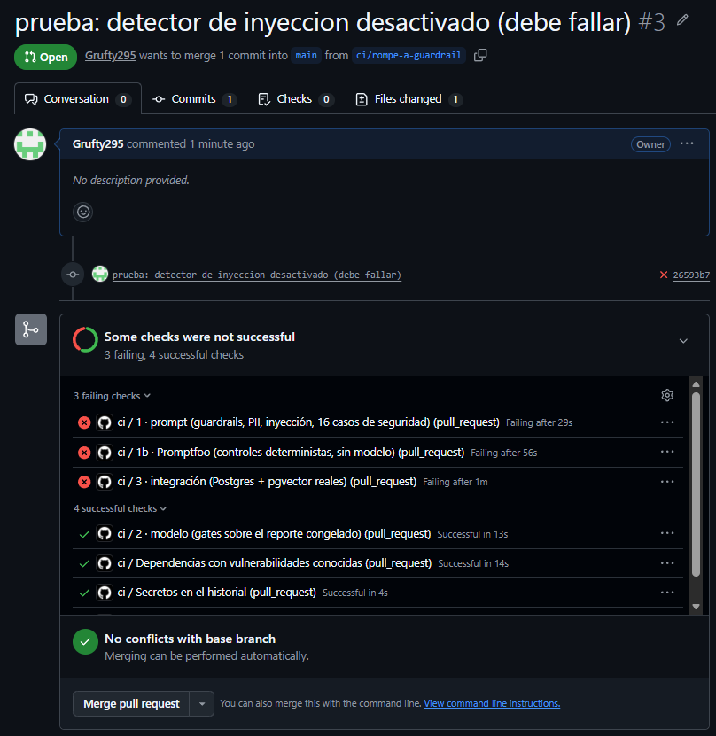

# Cómo probar el CI en GitHub Actions, paso a paso

Objetivo: tener **evidencia de que el CI funciona y de que bloquea**, no solo de que corre. Un pipeline que nunca ha
fallado no demuestra nada: la mitad de esta guía es romperlo a propósito.

Estado al 19 oct 2026: `ci.yml` ya corrió en Actions (rama `ci/primera-prueba`) y quedó en verde tras varias correcciones
(sección «Lo que falló en la primera corrida»). `evals-live.yml` también se ejecutó una vez, con dos correcciones previas.
**Falta la Fase 4**: probar que el CI *bloquea* (romperlo a propósito). Un verde solo demuestra que corre, no que protege.

## Fase 0. Antes de empujar (local, ~20 min)

Cada job de `ci.yml` tiene un equivalente local. Si falla aquí, fallará allá.

```bash
# 0.1 Lint estático de los workflows (atrapa errores de YAML y de expresiones ${{ }})
docker run --rm -v "$PWD":/repo -w /repo rhysd/actionlint:latest -color
```
```powershell
docker run --rm -v "${PWD}:/repo" -w /repo rhysd/actionlint:latest -color
```

```bash
# 0.2 Secretos en el historial (el job "secretos" falla si hay uno; mejor saberlo antes de publicar)
docker run --rm -v "$PWD":/repo zricethezav/gitleaks:latest detect --source /repo --verbose
# y confirma que .env no está versionado
git ls-files | grep -E '(^|/)\.env$' && echo "¡.env versionado!" || echo "ok: .env no está en git"
```

```bash
# 0.3 Capas 1 y 3 (necesitan una base Postgres+pgvector vacía; reutiliza la de pruebas)
cd apps/api
uv sync --group dev
uv run ruff check --select E9,F63,F7,F82 app tests
make -C ../.. test            # suite completa contra eightd_test (Makefile)
```

```bash
# 0.4 Capa 1b: Promptfoo (comandos en docs/seguridad/promptfoo.md). Debe dar 104/104, 21/21, 20/32 (62.5 %), 43/44 y 8/24 (33 %).
```

```bash
# 0.5 Capa 2: gates sobre el reporte congelado. Falla a propósito si no existe.
mkdir -p evals/reportes
cp traces/evals/dev-v6.json evals/reportes/agente.json
cp traces/evals/recuperacion.json evals/reportes/recuperacion.json
cd apps/api && uv run python -m app.evalkit.gates --out-dir ../../evals/reportes --variant con_enlaces --split dev
```

```bash
# 0.6 Web
cd apps/web && npm install --no-audit --no-fund && npx tsc --noEmit && npm run lint
```

Opcional, con límites claros: `act` (nektos/act) ejecuta workflows en Docker. Sirve para ver que los pasos arrancan; **no**
reproduce bien los `services:` ni los runners, así que un verde en `act` no garantiza un verde en Actions. No lo uses como
evidencia.

**Decisión previa: qué reporte congelar.** Para esta primera prueba, `dev-v6` (el que ya pasa los gates). Para el sello
final, el de la configuración definitiva (modelo, `reasoning.effort`, `max_tokens`). Cambiar el reporte congelado más tarde
es un PR normal y su diff es la evidencia.

## Fase 1. Repositorio en GitHub

```bash
# Si todavía no tienes remoto
gh auth login
gh repo create <usuario>/quality-root-cause-copilot --private --source=. --remote=origin --push
```

Los workflows tienen que estar en `.github/workflows/` **en la raíz del repo**. Si están en otra carpeta, no corren y no hay
ningún error que lo diga:

```bash
mkdir -p .github/workflows && cp ci.yml evals-live.yml .github/workflows/   # solo si aún no están ahí
```

Ajustes de la cuenta que **no** hacen falta para `ci.yml`: ningún secreto, ninguna variable, ninguna app. Actions viene
activo por defecto en repos nuevos. Solo `evals-live.yml` los necesita (Fase 6).

## Fase 2. Primera corrida (rama y PR)

```bash
git switch -c ci/primera-corrida
git add .github evals/reportes evals/promptfoo docs
git commit -m "ci: tres capas, promptfoo y reporte congelado"
git push -u origin ci/primera-corrida
gh pr create --fill --base main
gh run watch                      # sigue el run en la terminal
gh run list --limit 5             # estado de los últimos
gh run view --log-failed          # solo el log de lo que falló
```

Un PR abierto dispara `ci` por el evento `pull_request`. Si empujas directo a `main`, también corre (`push`), pero entonces
no hay nada que bloquear.

## Fase 3. Qué probablemente falla en la primera corrida, y por qué

Ordenado por probabilidad, según lo que el código dice (no es una medición):

| Síntoma | Causa probable | Arreglo |
|---|---|---|
| Capa 2: `Falta evals/reportes/agente.json` | `evals/reportes/` no está versionado | Fase 0.5 y `git add -f` si `.gitignore` lo cubre |
| Cualquier job: `uv sync` falla al construir un paquete | Una dependencia sin rueda para el runner (`fastembed`, `psycopg`) | Leer el log; fijar versión o añadir `apt-get install` del paquete de sistema |
| Capa 1/3: migraciones fallan | El orden de `ls | sort` no es el de las dependencias entre SQL, o falta la extensión `vector` | El servicio es `pgvector/pgvector:pg16`; revisa el primer `ERROR` del log |
| Capa 3: pruebas que pasan local pero fallan en CI | Dependencia de variables (`DATABASE_URL` apunta a `eightd_test`) o de archivos ignorados por git (`data/seed`) | Comparar `git ls-files` con lo que la prueba lee |
| `secretos` falla | Un secreto real en el historial, o el permiso del token en PR | Rotar el secreto; si es el permiso, añade `pull-requests: read` a `permissions` |
| `promptfoo` falla en el paso Python | `apps/api/.venv` no existe donde dice `PROMPTFOO_PYTHON` | Ver la ruta con `ls apps/api/.venv/bin` en un paso de depuración |
| `web` falla | `npm run lint` con reglas nuevas, o `tsc` por tipos de React Query | Corregir en local con 0.6 |
| `dependencias` en rojo/amarillo | Hay una vulnerabilidad conocida | No bloquea (`continue-on-error`); decide si se vuelve bloqueante |

### Lo que falló en la primera corrida (real, 19 oct 2026)

Esta tabla reemplaza a las hipótesis de arriba para esta corrida. Salvo la nota final, cada fila fue un arreglo en su commit.

| Job | Síntoma real | Causa | Arreglo |
|---|---|---|---|
| API (todos) | `uv sync` falla con `src/api/__init__.py` | `pyproject.toml` declaraba un paquete (`[project.scripts]`, `[build-system]`) que no existe: la API corre desde el código fuente | `[tool.uv] package = false` y `pythonpath = ["."]` para pytest; `uv.lock` pasa de `editable` a `virtual` |
| secretos | `gitleaks-action` falla por rango de commits | Con un commit raíz no hay rango anterior que escanear | Binario `gitleaks detect` con `fetch-depth: 0` (historial completo) |
| secretos | 13 hallazgos de `generic-api-key` | Historial: 7 literales de prueba/ejemplo y 6 valores de `.env.langfuse.example` que parecían reales | Los 6 se rotaron y se reemplazaron por placeholders; los 13 fingerprints en `.gitleaksignore` (ver `ci.md`) |
| dependencias | `pip-audit` rechaza los flags | `--disable-pip` exige hashes o `--no-deps` | `--no-deps` |
| web | `tsc`: no encuentra `LayoutProps` | Next 16 genera esos tipos globales | `npx next typegen` antes de `tsc` |
| web | 9 errores `no-explicit-any` | `drafts.tsx` tipado con `any` | Tipos explícitos (`CampoD2`, `D2Content`, `Causa`, `D4Content`) |
| evals-live | Seed: no existe `/workspace/data/seed/...` | Rutas del contenedor Docker | `--data` y `--evals` con `${{ github.workspace }}` |
| evals-live | `variantes desconocidas: ['base']` | La variante `base` no existe (las válidas son `sin_enlaces` y `con_enlaces`); también estaba en un `eval-smoke` que ya no está en el Makefile | `con_enlaces` (la de producción) |

Dos precisiones honestas: (1) una de las fallas «de CI» fue que el `ci.yml` nuevo no se había copiado al repo y los logs mostraban
el comportamiento viejo; se verifica que el run use el commit esperado antes de interpretar un rojo. (2) Ninguna de las fallas
de esta tabla era un fallo del *producto*: eran de configuración. La Fase 4 es la que mide si el CI atrapa fallos del producto.

Regla para arreglar: **un arreglo por commit y un push por arreglo**. Cada run tarda minutos; adivinar varios a la vez
hace que no sepas cuál funcionó. Y no desactives un job para ponerlo en verde: si un job no es válido, se documenta en
`ci.md` como límite, no se silencia.

## Fase 4. Probar que el CI bloquea (la evidencia que importa)

Haz cada prueba en una rama que sale de la rama verde. Para cada una: empuja, abre PR, espera el rojo, **captura la
pantalla de la página del run**, cierra el PR sin fusionar y borra la rama.

| # | Qué rompes | Cómo | Debe fallar |
|---|---|---|---|
| A | Un guardrail | Quita el patrón `ignorar_instrucciones` de `app/agent/guardrails/injection.py` | Capa 1 **y** Promptfoo (core) |
| B | La calidad congelada | En `evals/reportes/agente.json`, dentro de `aggregates` (variante `con_enlaces`, split `dev`), pon `unsafe_output_runs` en 1 o baja `pass@1` a 0.4 | Capa 2 (`salida-segura` y `pass-linea-base` son bloqueantes) |
| C | Un secreto | Escribe en un archivo una línea `OPENROUTER_API_KEY=` seguida de `sk-or-v1-` y 64 caracteres hex (comando abajo) | `secretos` |
| D | El umbral de regresión | Quita el patrón `descartar_reglas` de `injection.py` | Promptfoo (variantes, umbral 100) |
| E | La existencia del reporte | `git rm evals/reportes/agente.json` | Capa 2 con el mensaje "Sin dato no se aprueba" |
| F | Una migración rota | Añade un `.sql` con un error de sintaxis al final | Capas 1 y 3 |

```bash
# patrón para cada prueba (ejemplo C)
git switch ci/primera-corrida && git switch -c ci/rompe-secreto
echo "OPENROUTER_API_KEY=sk-or-v1-$(printf '0123456789abcdef%.0s' 1 2 3 4)" > prueba-secreto.txt   # se construye en vivo: el doc no lleva la cadena
git add prueba-secreto.txt && git commit -m "prueba: secreto falso (debe fallar)" && git push -u origin ci/rompe-secreto
gh pr create --title "PRUEBA: debe fallar" --body "No fusionar" --base ci/primera-corrida
gh run watch
# al terminar
gh pr close --delete-branch
```

En PowerShell (prueba C): `"OPENROUTER_API_KEY=sk-or-v1-" + ("0123456789abcdef" * 4) | Set-Content prueba-secreto.txt -Encoding ascii`.
Nota: la cadena **no se escribe literal en este documento** a propósito; hacerlo disparó `gitleaks` sobre este mismo archivo (13
hallazgos de historial, ver `ci.md`). Sobre `gitleaks` y la rama de prueba: el job escanea todo el historial, así que falla por
el commit nuevo aunque el valor sea falso.

Importante con C: el secreto de prueba **queda en el historial de esa rama**. No lo empujes a `main`. Usa un valor falso con la
forma de una llave, nunca una real. Si sospechas que algo real se filtró, rota la llave en el proveedor.

### Resultados de la Fase 4

| # | Prueba | Resultado (19 oct 2026) | Evidencia |
|---|---|---|---|
| A | `detect_injection` desactivado (`views` vacío) | **Rojo como se esperaba**: fallaron `1 · prompt` (29 s), `1b · Promptfoo` (56 s) y `3 · integración` (1 min). Pasaron `2 · modelo`, `Dependencias` y `Secretos`. | `ci-prueba-a-rojo.png` |
| B | Reporte congelado con `unsafe_output_runs` = 1 | No ejecutada | — |
| C | Secreto falso en un archivo | No ejecutada | — |
| D, E, F | Umbral de regresión, reporte ausente, migración rota | No ejecutadas | — |



Lo que enseñó la prueba A, más allá de «bloquea»:
- **`3 · integración` también cayó**, porque la suite completa ejecuta los casos adversariales. Una regresión del detector se detecta por tres caminos, no por uno.
- **`2 · modelo` siguió en verde**, como ya declara `ci.md`: evalúa un reporte congelado, no el código. Un guardrail roto no la toca; la protegen las capas 1, 1b y 3.
- **El PR rojo se podía fusionar**: el botón «Merge pull request» seguía activo. No hay protección de rama (no se configuró), así que el CI **avisa pero no impide**. Hasta que se active, «bloquea» describe el diseño del CI y no un control forzado.

Las pruebas B a F no se ejecutaron por tiempo; el estado de cada una está en la tabla y no se presenta como probado.

Si una de estas pruebas **pasa en verde**, encontraste un hueco del CI: es el hallazgo más valioso de esta fase, anótalo en
`ci.md` ("Qué NO hace este CI").

## Fase 5. Que el rojo impida fusionar

Hasta aquí el CI avisa; no impide nada. Para que bloquee hay que exigir los checks en `main`.

**Límite de la cuenta:** las reglas de protección de rama **no están disponibles en repos privados del plan gratuito**.
Opciones: hacer el repo público (los datos son sintéticos; revisa antes con 0.2), usar un plan que las incluya, o declarar
en el runbook que la protección es una convención. No lo dejes implícito.

Si están disponibles, los nombres de los checks son los de `name:` de cada job, que son largos y con caracteres como `·`.
Es más estable verlos y copiarlos:

```bash
gh pr checks            # nombres exactos de los checks del PR actual
gh api repos/{owner}/{repo}/branches/main/protection -X PUT --input - <<'JSON'
{
  "required_status_checks": { "strict": true, "contexts": ["<pega aquí los nombres de gh pr checks>"] },
  "enforce_admins": false,
  "required_pull_request_reviews": null,
  "restrictions": null
}
JSON
```

Alternativa en la interfaz: Settings → Branches → Add rule → "Require status checks to pass".

## Fase 6. `evals-live.yml` (manual, gasta tokens)

Solo después de que `ci` esté en verde. **Dos requisitos de GitHub:** un workflow con `workflow_dispatch` solo se puede lanzar
si el archivo ya está en la rama por defecto, así que primero se fusiona el PR de la Fase 2.

```bash
gh secret set OPENROUTER_API_KEY                       # pega la llave cuando la pida
gh variable set LLM_MODEL     --body "qwen/qwen3.6-27b"
gh variable set LLM_PRICE_IN  --body "0.32"
gh variable set LLM_PRICE_OUT --body "3.20"
gh workflow run evals-live.yml -f casos="EV-01"        # un caso primero (barato) y confirma que arranca
gh run watch
gh run download --name reporte-eval -D traces/ci-humo
```

Resultado de la primera corrida completa (19 oct 2026, 3 casos EV-01, EV-05, EV-09; `con_enlaces`; 1 repetición): 3 válidas,
0 inválidas, 0 salidas inseguras, RC top1 1.00, pass@1 0.67 (falló EV-01 en el criterio de no-dato, no en la causa), US$0.054
estimado / US$0.050 reportado, p50 238 s con concurrencia 3 (incluye cola del proveedor). Es una prueba de funcionamiento
del camino, no de calidad: n = 3. Referencia anterior: `humo-qwen27` (3/3, US$0.0357 por corrida) fue otra muestra y otra
configuración; no se comparan como tendencia. No se congela este reporte en `evals/reportes/`.

## Fase 7. Qué guardar como evidencia para la defensa

- Captura del run verde en las tres capas más Promptfoo, con el resumen de gates (`$GITHUB_STEP_SUMMARY`).
- Capturas de al menos A, B y C en rojo (Fase 4).
- El artefacto `reporte-promptfoo` (HTML) y el de `evals-live`.
- La lista de lo que falló en la primera corrida y cómo se arregló: una pantalla de "lo que aprendí rompiéndolo" convence más
  que una de "todo verde".

## Límites que se dicen en voz alta

- Capa 2 evalúa un reporte congelado, no el modelo (ver `ci.md`).
- Un CI en verde con LLM falso no prueba que el modelo real obedezca.
- Sin protección de rama, nada impide fusionar un PR en rojo.
- No hay despliegue automatizado: el CI termina en "listo para fusionar".