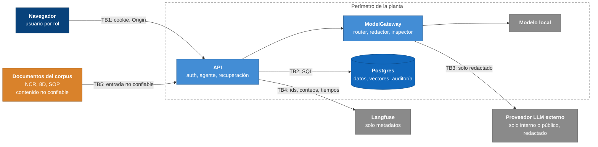

# Modelo de amenazas

Alcance: el sistema completo del PoC (ver [c4.md](../arquitectura/c4.md)). Los datos son sintéticos; el análisis supone datos reales de una planta.
Cada control cita su evidencia (prueba o archivo). Lo que no está probado se dice.

## Activos

| Activo | Por qué importa |
|---|---|
| Nombres de clientes, números de parte y programas | Contractualmente confidenciales; no pueden salir de la planta |
| PII de operadores (nombre, nómina, correo, teléfono) | Datos personales; el agente no debe nombrarlos ni culparlos |
| Borradores D2/D4 y su historial | Decisión de calidad; un 8D aprobado es un registro formal |
| `audit_log` | Prueba de qué se envió y adónde |
| Corpus indexado y vectores | Contienen lo anterior |

## Fronteras de confianza

TB5 es la menos intuitiva: **un documento recuperado es entrada no confiable**, aunque lo haya escrito la propia planta.

## Amenazas y controles

| # | Amenaza | Control | Evidencia | Riesgo residual |
|---|---|---|---|---|
| T1 | Inyección en la descripción de la NCR | `guard_input` detiene la corrida antes de cualquier llamada al modelo | `test_adv_injection_in_the_ncr_stops_the_run_before_any_model_call` (ADV-01, 02, 03, 05); `evals/promptfoo/` (54 casos + 21 + 32 variantes) | El detector es por patrones: un atacante paciente lo rodea. Medido: 20 de 32 ataques de validación (62.5 %, estimación optimista) con 0 falsos positivos en 1,288 párrafos legítimos; antes de la mejora, 6 de 30 (20 %). Sin medición independiente todavía (`promptfoo.md`). Es la capa débil, declarada |
| T2 | Inyección en un documento recuperado | Cuarentena de fragmentos con patrones; el fragmento no entra al prompt | `test_adv_06_the_same_injection_inside_an_indexed_document_is_quarantined` | Igual que T1 |
| T3 | La inyección logra influir en el modelo | Las tools las llama el código, son de solo lectura y tienen presupuesto; el modelo no elige destinos de red ni SQL; el agente no cierra un 8D; salida validada | `test_adv_05_the_agent_has_no_tool_that_can_send_or_write_anything`, `test_agent_cannot_close_an_8d` | No se midió con un modelo real si una entrada adversarial cambia la causa elegida o las fuentes. Los guardrails de salida marcan 8 de 24 frases nuevas de culpa o cierre (33 %), con 0 falsos positivos; el gate `salida-segura` es circular (`promptfoo.md`) |
| T4 | Exfiltrar un documento completo en la salida | `Hecho.texto` ≤ 500 caracteres; esquema con `extra=forbid`; ids de fuente verificados | `test_adv_04_a_whole_document_cannot_be_persisted_and_the_ncr_stays_local` | — |
| T5 | Fuga de cliente, parte o programa a la API | Router por nivel más alto del contexto; redactor; inspector que bloquea; `CHECK` en la base | `tests/agent/llm/test_gateway_redaction.py`, `test_llm_gateway.py`, ADV-08 y ADV-09 | El catálogo no se recarga si cambia; un programa del cliente sin la palabra "programa … del OEM/cliente" no se reconoce |
| T6 | Un documento que se declara "público" en su texto | El nivel lo manda el front matter, no el cuerpo | `test_adv_07_a_document_that_claims_to_be_public_keeps_the_level_of_its_front_matter` | Un front matter mal etiquetado se hereda; sin front matter, el documento es confidencial |
| T7 | PII hacia un modelo | Seudónimos de persona, nómina, correo y teléfono, incluso hacia el local | `test_adv_10_pii_is_pseudonymized_in_every_payload_even_to_the_local_model` | Un nombre sin rol ni etiqueta delante no se detecta (límite documentado) |
| T8 | Acceso a otra planta o línea | Alcance en la API, en las tools y dentro de `visible_fragments` antes del ranking | `test_permission_case_per_01`, `test_only_engineers_run_the_agent_and_scope_applies`, `test_scope_is_enforced` | — |
| T9 | Ver el futuro o citar el propio caso | `as_of` y `exclude_sources` en búsqueda, enlaces y tools | `test_as_of_excludes_future_documents`, `test_as_of_hides_future_maintenance` | — |
| T10 | Elevación de privilegios / aprobar lo propio | Roles verificados en servidor; trigger en la base | `test_only_manager_approves`, `test_who_opened_cannot_approve` | Login de demo sin contraseña; en producción exige un IdP |
| T11 | Edición humana que rompe el formato | `validate_content` con los esquemas del agente | `tests/test_ncr_content.py` | — |
| T12 | Alteración del historial | Solo inserción, hash encadenado, `audit_verify()` | `tests/agent/llm/test_audit_db.py`, `make audit` | Un administrador de la base puede reescribir la cadena; no hay ancla externa |
| T13 | Repetición o concurrencia sobre el mismo análisis | `Idempotency-Key`, 409 si cambiaron las versiones | `test_concurrent_change_while_model_works_is_a_conflict` | — |
| T14 | Fuga por errores y trazas | El observador solo recibe ids, conteos, tiempos y códigos; los reportes de `reasons` no incluyen valores | `tests/agent/test_observe.py`, `test_reasons_never_contain_the_matched_value` | No se forzaron fallos en cada etapa para revisar todos los destinos de log |
| T15 | Abuso de recursos / costo | Presupuesto de 17 llamadas a tools, `max_attempts`, timeouts; tope de análisis simultáneos (global 8, por usuario 2, 429 con `Retry-After`, `app/agent/limits.py`) | `test_call_budget_is_enforced`, `tests/agent/test_limits.py`, `test_limits_db.py` | Los topes cubren `/analyze`; **no hay límite de tasa en login ni en lecturas, ni cuota de costo con alerta**. Los topes son por proceso y sus valores aún no se contrastan con el punto de saturación medido |
| T16 | CSRF | Cookie `SameSite=Lax` + comprobación de `Origin` | `tests/test_auth.py` | `COOKIE_SECURE=false` por defecto |

## OWASP Top 10 para aplicaciones LLM (2025)

| Riesgo | Cobertura | Brecha |
|---|---|---|
| LLM01 Prompt Injection | T1–T3 | Detector por patrones; falta medirlo con el modelo real |
| LLM02 Divulgación de información sensible | T5–T7, T14 | Redactor heurístico; el "local" es simulado |
| LLM03 Cadena de suministro | Modelos fijos por slug (`MODEL_SMALL`/`LARGE`), `uv.lock`, `data_collection=deny` | Sin SBOM ni auditoría de dependencias en CI |
| LLM04 Envenenamiento de datos y modelos | El corpus entra por una carpeta controlada con tipos de documento permitidos; un tipo desconocido falla en voz alta | Sin firma ni procedencia de documentos |
| LLM05 Manejo inadecuado de la salida | Esquema estricto, guardrail de citas y culpa, aprobación humana, `validate_content` | — |
| LLM06 Agencia excesiva | Tools de solo lectura llamadas por el código; el agente no cierra ni aprueba | — |
| LLM07 Filtración del prompt del sistema | El prompt no contiene secretos ni datos | Se asume extraíble |
| LLM08 Vectores y embeddings | Permisos antes del ranking; embeddings locales; filtro por modelo de embedding | Los vectores son datos sensibles: la base depende de `127.0.0.1` y del volumen |
| LLM09 Desinformación | Citas verificadas, abstención como salida válida, revisión humana | La abstención no se activa (0 de 36); RC top-1 = 0.75 en dev |
| LLM10 Consumo no acotado | Presupuesto de tools, reintentos y timeouts | Tope de simultáneos en `/analyze`; sin cuota de costo ni límite en el resto de rutas (T15) |

## Brechas abiertas, por prioridad

1. Cuota de costo por usuario con alerta al 80 % y límite de tasa en login y lecturas (el tope de `/analyze` ya existe; el resto es diseño, sin construir).
2. Medir con el modelo real el efecto de los 10 adversariales sobre la causa elegida y las fuentes.
3. Purga de `pseudonym_map` al vencer `expires_at` (la retención está definida, la purga no).
4. Ancla externa del hash de cabeza de `audit_log` y rol de base de solo inserción.
5. Secret manager, escaneo de secretos y de dependencias en CI.
6. Modelo local real: sin él, "lo confidencial no sale de la planta" es un diseño, no una propiedad medida.
